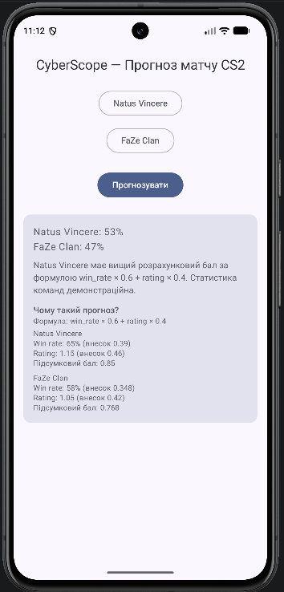

# CyberScope: CS2 Match Predictor

Мобільний додаток для фанатів кіберспорту (CS2). MVP реалізує один завершений сценарій:
користувач обирає дві команди, backend розраховує ймовірність перемоги, а застосунок
показує результат і пояснення розрахунку.

- **ЛР2:** MVP «mobile → backend → результат».
- **ЛР3:** Knowledge Base (`docs/`), контрольована розробка з coding agent, нова функція «Чому такий прогноз?» (розбивка розрахунку).

## Ідея

На відміну від HLTV, який надає лише сирі дані, додаток пропонує аналітику:
прогноз ймовірності перемоги команди на основі статистики та пояснення, звідки взявся цей відсоток.

Повна концепція (ЛР1): розклад турнірів, профілі команд і гравців, історія матчів, пошук та фільтрація.
Реалізовано лише прогнозування матчу.

## Архітектура

Android (Kotlin, Jetpack Compose) → HTTP/JSON → FastAPI backend → алгоритм прогнозування → відповідь у застосунок.

Детальний опис: [`docs/architecture.md`](docs/architecture.md).

## Структура репозиторію

- `mobile/`: Android Studio проєкт (Kotlin, Jetpack Compose)
- `backend/`: FastAPI сервіс (`main.py`, `requirements.txt`, `tests/`)
- `docs/`: Knowledge Base проєкту
- `docs/screenshots/`: скріншоти

## Вимоги

- Python 3.10+
- Android Studio з емулятором (або телефон)
- Git

## Запуск backend

```
cd backend
python -m venv venv
venv\Scripts\activate
pip install -r requirements.txt
uvicorn main:app --reload
```

Swagger UI: http://127.0.0.1:8000/docs

## Запуск mobile

1. Відкрити папку `mobile/` в Android Studio, дочекатись Gradle sync.
2. Запустити емулятор (Device Manager).
3. Прокинути порт backend на емулятор (повторювати після кожного перезапуску емулятора).
4. Натиснути Run ▶.

Команда для кроку 3:

```
adb reverse tcp:8000 tcp:8000
```

Якщо `adb` не знайдено (PowerShell):

```
& "$env:LOCALAPPDATA\Android\Sdk\platform-tools\adb.exe" reverse tcp:8000 tcp:8000
```

Адреса backend у застосунку: `http://127.0.0.1:8000` (файл `ApiClient.kt`).

Список команд завантажується один раз при відкритті екрана, тому backend має бути запущений
**до** старту застосунку.

## Тести

Unit-тести backend написані на стандартному `unittest` (без нових залежностей).
Запуск з папки `backend`, з активованим `venv`:

```
cd backend
venv\Scripts\activate
python -m unittest discover -s tests -v
```

Очікуваний результат: 4 тести, у кінці `OK`. Ручні сценарії для mobile та регресії:
[`docs/testing.md`](docs/testing.md).

## API

| Endpoint | Метод | Призначення |
|---|---|---|
| `/health` | GET | Перевірка доступності |
| `/teams` | GET | Список команд зі статистикою |
| `/predict` | POST | Прогноз результату матчу |

Приклад запиту:

```json
POST /predict
{ "team_a_name": "Natus Vincere", "team_b_name": "FaZe Clan" }
```

Приклад відповіді (200). П'ять перших полів з ЛР2, десять останніх додано в ЛР3:

```json
{
  "team_a_name": "Natus Vincere",
  "team_b_name": "FaZe Clan",
  "team_a_win_probability": 0.53,
  "team_b_win_probability": 0.47,
  "explanation": "Natus Vincere має вищий розрахунковий бал за формулою win_rate × 0.6 + rating × 0.4. Статистика команд демонстраційна.",
  "team_a_win_rate": 0.65,
  "team_a_rating": 1.15,
  "team_a_win_rate_contribution": 0.39,
  "team_a_rating_contribution": 0.46,
  "team_a_score": 0.85,
  "team_b_win_rate": 0.58,
  "team_b_rating": 1.05,
  "team_b_win_rate_contribution": 0.348,
  "team_b_rating_contribution": 0.42,
  "team_b_score": 0.768
}
```

Помилки:

| Код | Причина | Відповідь |
|---|---|---|
| 400 | Однакові команди | `{"detail": "Оберіть дві різні команди"}` |
| 404 | Команду не знайдено | `{"detail": "Команду '...' не знайдено"}` |
| 422 | Порожнє поле | Стандартна валідація Pydantic |

Повний контракт: [`docs/api-contract.md`](docs/api-contract.md).

## Інтелектуальний компонент

Базовий алгоритм (допускається методичкою), реалізований у функції `calculate_prediction()`:

```
score = win_rate * 0.6 + rating * 0.4
P(A) = score_A / (score_A + score_B)
```

Статистика 6 команд зберігається в `TEAMS_DB` (hardcoded) і є демонстраційною.

Приклади використання:

| № | Команда A | Команда B | Результат A / B | Висновок |
|---|---|---|---|---|
| 1 | Natus Vincere | FaZe Clan | 53% / 47% | NAVI фаворит |
| 2 | Vitality | MOUZ | 55% / 45% | Vitality фаворит |
| 3 | G2 Esports | Spirit | 49% / 51% | Майже рівні шанси |
| 4 | Vitality | Natus Vincere | 51% / 49% | Майже рівні шанси |
| 5 | MOUZ | FaZe Clan | 49% / 51% | Майже рівні шанси |

Деталі: [`docs/ai-component.md`](docs/ai-component.md).

## Пояснення розрахунку (ЛР3)

Під відсотками картка результату показує блок «Чому такий прогноз?»: формулу, а для кожної команди
win rate, rating, внесок кожного показника та підсумковий бал. Наприклад, для Natus Vincere
65% × 0.6 = 0.39 і 1.15 × 0.4 = 0.46, разом 0.85, а для FaZe Clan 0.348 + 0.42 = 0.768, звідси 53% / 47%.

Якщо після округлення шанси рівні, пояснення не називає фаворита.



## Стани інтерфейсу

Початковий → Завантаження → Успіх / Помилка. Повторний запит працює без перезапуску застосунку.

## Knowledge Base

Документація проєкту для людей і coding agent:

- [`ai-instructions.md`](docs/ai-instructions.md): правила роботи coding agent
- [`project-overview.md`](docs/project-overview.md): проблема, користувач, межі MVP
- [`requirements.md`](docs/requirements.md): вимоги та їхній статус
- [`architecture.md`](docs/architecture.md): компоненти та потік даних
- [`api-contract.md`](docs/api-contract.md): endpoints, моделі, помилки
- [`ai-component.md`](docs/ai-component.md): алгоритм прогнозу
- [`testing.md`](docs/testing.md): тести та ручні сценарії
- [`known-limitations.md`](docs/known-limitations.md): відомі обмеження
- [`decisions.md`](docs/decisions.md): технічні рішення

## Скріншоти


## Безпека

- API keys у коді відсутні
- Передаються лише назви команд, персональних даних немає
- Помилки повертаються як `{"detail": ...}` без stack trace
- Android permissions: лише `INTERNET`

## Обмеження поточної версії

- Дані команд hardcoded, реальні джерела (HLTV, Liquipedia) не підключені
- Прогноз базується на простій формулі, а не на навченій ML-моделі
- HTTP без шифрування (`usesCleartextTraffic`) і відкритий CORS: лише для розробки
- Конфігурація не винесена в environment variables
- Адреса backend прописана в коді
- Unit-тести не перевіряють HTTP-шар, для mobile є лише ручні сценарії

Повний список: [`docs/known-limitations.md`](docs/known-limitations.md).
